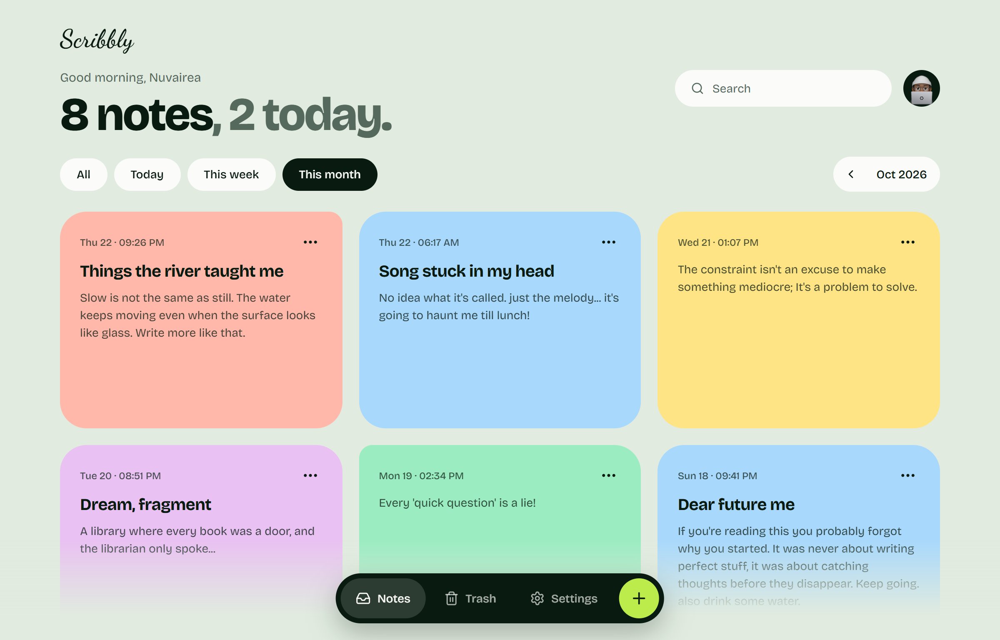
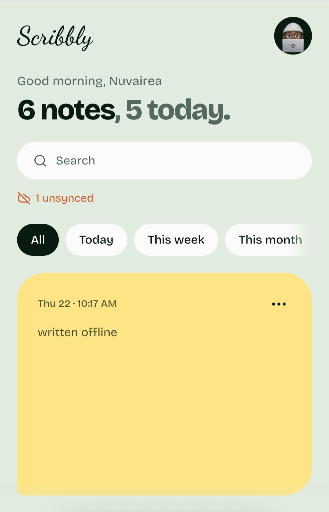
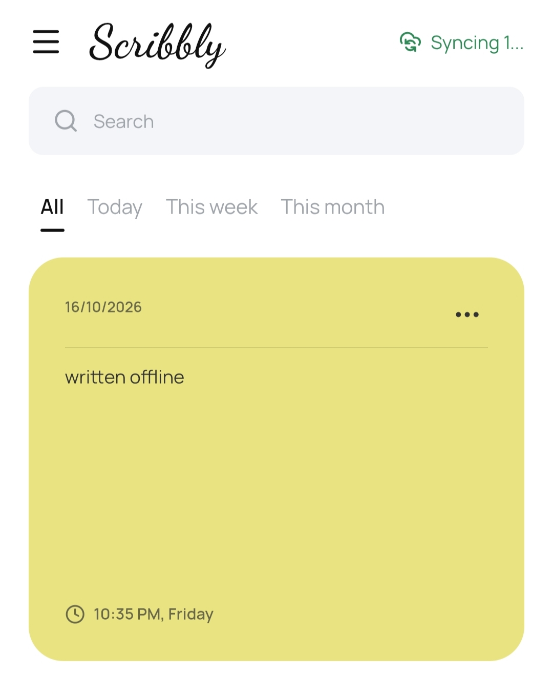
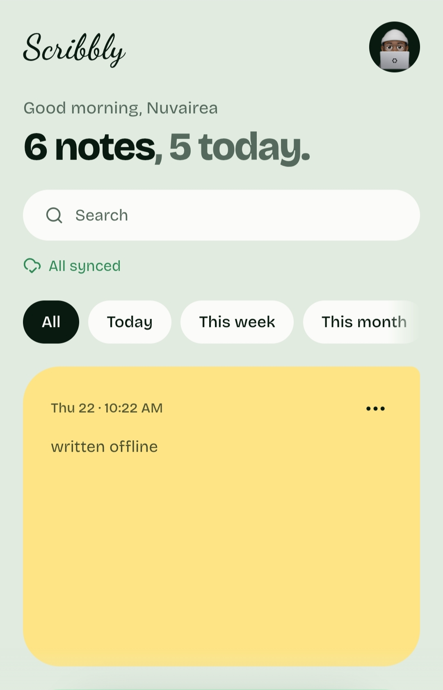

# Scribbly

> Offline first space for notes, thoughts, and scribbles.

<p align="center">
  <a href="https://scribbly-app.onrender.com">
  
</a>
  <a href="https://github.com/nuvairea/scribbly/releases/tag/v3.1.0"></a>
  <a href="https://react.dev"></a>
  <a href="https://vitejs.dev"></a>
  <a href="./LICENSE"></a>
</p>

Write freely, stay in flow, and keep your thoughts close, even without a connection.

<p align="center">
  
</p>

## Features

Scribbly lets you create, edit, and color-tag notes, search across your notes, and filter them by today, this week, or this month. Deleted notes are moved to trash, where they can be recovered or permanently removed.

You can sign in with Google or continue as a guest. Signed-in users can automatically sync their notes, while offline changes are saved locally and retried automatically when a connection is available.

Scribbly also includes light and dark themes with system preference support, and installs as a PWA that works offline.

Account and data management is available from Settings, including exporting notes as JSON, permanently clearing the trash, and deleting your account.

## How sync works

|                                             Offline                                             |                                            Syncing                                             |                                          Synced                                           |
| :---------------------------------------------------------------------------------------------: | :--------------------------------------------------------------------------------------------: | :---------------------------------------------------------------------------------------: |
|  |  |  |

Scribbly is local first. Every change is written to local storage right away, so the UI never waits on the network.

When you're signed in, each change is also sent to the server in the background. Until the server confirms it, the note is marked as pending. If a request fails, it's retried, and after 5 failed attempts the note is flagged as a sync error.

Pending notes are flushed again when the app loads and whenever the browser comes back online. On login, notes are pulled from the server, and any notes you created as a guest are uploaded once.

Guest mode never touches the network.

## Built with

- **Frontend:** React + TypeScript and Vite
- **Styling:** CSS Modules
- **Animations:** [Motion](https://motion.dev)
- **Icons:** Lucide
- **Auth:** Google OAuth
- **PWA:** installable, works offline
- **Backend:** [scribbly-server](https://github.com/nuvairea/scribbly-server) (Node.js, Express, MongoDB)
- **Deployment:** Render, with GitHub Actions

## Run locally

```bash
git clone https://github.com/nuvairea/scribbly.git
cd scribbly
npm install
npm run dev
```

Guest mode works without the backend. For login and sync, run [scribbly-server](https://github.com/nuvairea/scribbly-server) locally (setup is in its README), then create a `.env` file in the project root:

```bash
VITE_API_URL=Your server URL
VITE_GOOGLE_CLIENT_ID=Your Google OAuth client ID
```

`VITE_API_URL` is for local development only. In production the app calls `/api`, which is rewritten to the server so auth cookies stay first party. `VITE_GOOGLE_CLIENT_ID` is needed in both.

## License

This project is licensed under the [MIT License](./LICENSE).
